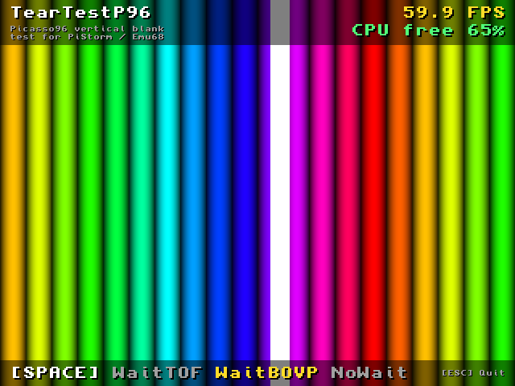

# TearTestP96

Shows screen tearing on a Picasso96 screen, and what waiting for the vertical blank costs.

Each frame is composed in fast memory, then copied to a 32-bit screen with `p96WritePixelArray()`, the way a
game ported with SDL or MiniGL shows its frames. The picture is colour bars scrolling sideways with a white
bar bouncing over them: when the screen is scanned while a frame is copied, the bars break in two.



WaitBOVP on a Raspberry Pi 3B with the vertical blank interrupt. A capture reads the picture from memory, so it
cannot show tearing: that happens on the way to the monitor, run the program to see it.

## Running

```
TearTestP96                                  ; 640x480, WaitBOVP
TearTestP96 MODE=NoWait WIDTH=800 HEIGHT=600
TearTestP96 MODE=WaitTOF SECONDS=30          ; quits after 30 s and prints the averages
```

| Key | |
|---|---|
| SPACE | next wait mode |
| ESC | quit (Ctrl-C also works) |

| Argument | |
|---|---|
| `MODE/K` | `WaitBOVP` (default), `WaitTOF` or `NoWait` |
| `SECONDS/N` | quit after that many seconds and print FPS, timings and CPU free |
| `WIDTH/N`, `HEIGHT/N` | screen size, 640x480 by default; the nearest 32-bit mode is taken |

Needs `Picasso96API.library` 2 or later and a 32-bit screen mode.

## What to look at

Before each copy the program waits for:

| Mode | Waits for | On screen |
|---|---|---|
| `WaitBOVP` | the vertical blank of the graphics card | smooth, at most a thin line at the very top |
| `WaitTOF` | the vertical blank of the Amiga chipset, a different video output | a clean cut, still or drifting |
| `NoWait` | nothing | bars broken all over |

Top right: frames a second, and **CPU free**, the time left to the other tasks (counted by a task at the
lowest priority). If the graphics driver has a vertical blank interrupt, `WaitBOVP` sleeps until the blank.
Without one, the wait is a busy loop: CPU free drops to 0% and frames are missed.

## Why the interrupt matters: VideoCore.card on PiStorm / Emu68

A program that waits for the vertical blank asks `rtg.library`, which asks the graphics driver. Two ways:

- **Without an interrupt**, the driver reads the display status in a loop until the blank comes. The CPU spins
  for the rest of the frame, up to 16.7 ms at 60 Hz: nothing else runs, CPU free is 0%, and a frame is missed
  now and then.
- **With an interrupt**, the waiting task sleeps. At the blank the display raises an interrupt, the driver
  acknowledges it and wakes the tasks that wait. The whole wait is given back to the system: the game gets the
  same 60 FPS, smoother, and the rest of the frame goes to the other tasks.

On the Raspberry Pi the interrupt of the display goes through the interrupt controller of the ARM side, which
an AmigaOS driver cannot use directly. `VideoCore.card` (the Picasso96 driver of Emu68) uses a library for it:

- **Raspberry Pi 4 / CM4**: [gic400.library](https://github.com/rondoval/emu68-gic400-library), for the
  GIC-400 controller of the BCM2711; it is in the Emu68 ROM.
- **Raspberry Pi 3 / Zero 2**: [arm-intc.library](https://github.com/flype44/arm-intc.library), its counterpart
  for the ARM interrupt controller of the BCM2837, a disk library in `LIBS:` (its use by `VideoCore.card` is
  being proposed).

Both let several drivers share the interrupt lines (the USB of a Pi 3 uses the same library, for example). The
driver adds a handler to the line of the display, sets `BIF_VBLANKINTERRUPT`, and Picasso96 lets `WaitBOVP()`
and the double buffering sleep instead of spinning. Without the library (or with `INTERRUPT=No` in the monitor
icon), the driver works as before, without the interrupt.

## Results

Raspberry Pi 3B, PiStorm32 lite, Emu68 1.0.7, legacy Picasso96 (rtg.library 40.39), VideoCore.card with the
vertical blank interrupt (through `arm-intc.library`), and the same driver with `INTERRUPT=No` in the monitor
icon. 30 s per run.

| 640x480 | with the interrupt | without |
|---|---|---|
| WaitBOVP | 59.9 FPS, **56% free** | 57.8 FPS, 0% free |
| WaitTOF | 59.9 FPS, 59% free | 59.1 FPS, 59% free |
| NoWait | 146.9 FPS, 0% free | 146.5 FPS, 0% free |

| 800x600 | with the interrupt | without |
|---|---|---|
| WaitBOVP | 59.9 FPS, **47% free** | 57.8 FPS, 0% free |
| WaitTOF | 59.9 FPS, 48% free | 59.0 FPS, 48% free |
| NoWait | 115.0 FPS, 0% free | 114.2 FPS, 0% free |

Composing a 640x480 frame takes about 4 ms and copying it about 2 ms; at 800x600, 5.3 ms and 3.2 ms.

With the interrupt, a thin cut can remain on the first lines in `WaitBOVP`: the display reads them during the
blank already, before the program is woken up (about 0.2 ms after the interrupt).

## Building

bebbo's `m68k-amigaos-gcc` with libnix:

```
make
```

One source file, `TearTestP96.c`, in sections: settings, state, pixels, text, picture, the idle task (CPU free),
measures, screen, main.
